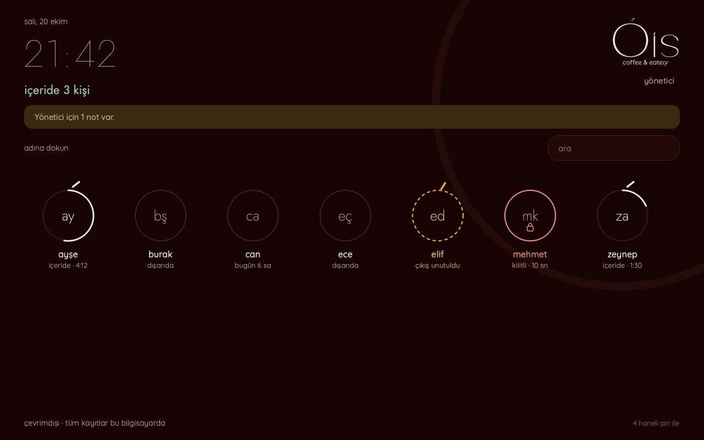

# Vardiya Takip · Ó'is coffee & eatery



Personel, logodaki “Ó” gibi ince bir halkayla gösterilir: içerideyken halkanın şapkası yanar ve
halka vardiya ilerledikçe (8 saatte) dolar. Çıkışı unutulan kayıt kesik bal sarısı, PIN’i kilitlenen
personel gül kurusu halkayla görünür. Koyu (bordo gece), gece siyahı ve açık (krem kâğıt) tema Yönetici → Ayarlar’dan
seçilir. Yazı tipleri Jost ve Quicksand (SIL Open Font License) uygulamaya gömülüdür.


Tek bilgisayarda, internet gerektirmeden çalışan Türkçe restoran/kafe personel takibi.
Python 3.12+, PySide6 ve SQLite. Fare/klavye ve büyük dokunmatik düğmelerle kullanım.

**Bu uygulama resmî bordro üretmez.** Giriş–çıkış sürelerinden saatlik ücret üzerinden
ön hak ediş hesaplar. Vergi, prim, izin, fazla mesai katsayısı veya yasal kesinti hesabı içermez.
Mola ve planlanan vardiya özellikleri yoktur.

## Windows’ta başlatma (Python gerekmez)

1. https://github.com/mfcknt/vardiya-takip/releases/latest adresinden **VardiyaTakip-Kurulum.exe**’yi indirin.
2. Çift tıklayın, **İleri → Kur**. Yönetici izni gerekmez; Başlat menüsüne ve masaüstüne kısayol eklenir.
   “Windows bilgisayarınızı korudu” uyarısında **Ek bilgi → Yine de çalıştır**’ı seçin (uygulama kod imzalı değildir).
3. Güncellemek için yeni kurulum dosyasını aynı şekilde çalıştırın; kayıtlar korunur.
   Kaldırma: Ayarlar → Uygulamalar → Vardiya Takip → Kaldır (veriler `%LOCALAPPDATA%\VardiyaTakip` içinde kalır).

Kurulumsuz kullanım için aynı sayfadaki ZIP’e sağ tıklayıp **Tümünü ayıkla** deyin ve ayıklanan klasördeki
`VardiyaTakip.exe`’yi açın. ZIP’in içinden doğrudan çalıştırmak “Failed to load Python DLL” hatası verir.

Not: Depo sayfasındaki **Code → Download ZIP** yalnızca kaynak kodu indirir; `.exe` içermez.

## Kaynaktan çalıştırma (geliştirme)

1. Proje ZIP dosyasını yerel bir klasöre çıkarın.
2. Python 3.12 x64 kurulu olsun. İlk kurulum için internet gerekir.
3. `Kurulum.cmd` dosyasını açın. Bağımlılıkları kurar ve testleri çalıştırır.
4. `Baslat.cmd` dosyasını açın.
5. İlk açılışta 4 haneli bir yönetici şifresi belirleyin (personel PIN’lerinden farklı).
6. Yönetici → Personel → Personel ekle: ad soyad, 4 haneli PIN, saatlik TL ücretini girin.
7. Ana ekranda personelin halkasına dokunun ve PIN’i girin; 4. rakamda işlem kendiliğinden yapılır.

Varsayılan şifre, önceden tanımlı personel veya gizli şifre sıfırlama yolu yoktur.
Kurulumdan sonraki normal kullanım internetsizdir. Bulut bağlantısı, telemetri veya sunucu yoktur.

Hazır Windows paketi üretmek için [Windows dağıtım yönergesini](docs/WINDOWS.md) izleyin.
Her `main` gönderiminde GitHub Actions Windows üzerinde tüm testleri çalıştırır ve
`VardiyaTakip-Windows-x64` paketini (EXE klasörü, ZIP) iş akışı çıktısı olarak üretir.

## İçerik

- Personel kartları, arama, ekran üstü PIN tuş takımı, maskeli PIN, 60 saniyelik giriş penceresi.
- Tek kişi için tek açık kayıt; aynı gün sınırsız sayıda ayrı giriş–çıkış.
- Açık kayıtların kapanma/yeniden başlatma sonrasında korunması.
- Ayrı yönetici şifresi, 5 dakika hareketsizlikte panelin kapanması.
- Personele özel ücret, ücret değişikliği geçmişi, giriş anında sabitlenen kayıt ücreti.
- Günlük veya tarih aralığı/aylık hak ediş; açık çalışmanın ayrı geçici tahmini.
- Ödeme/avans ekleme, gerekçeli iptal; devreden ve dönem sonu bakiyesi.
- Eksik kayıt ekleme, giriş–çıkış düzeltme, gerekçeli kayıt iptali; önce/sonra işlem geçmişi.
- CSV özet, çok sayfalı Excel raporu ve işlem geçmişi CSV çıktısı.
- Bütünlük ve işlem zinciri denetimi, doğrulanan yedek, yedekten kurtarma.
- Saat geri alma/ileri sıçrama şüphesinde kayıtlar durmaz, yönetici incelemesine işaretlenir; uzun açık kayıt uyarısı.
- Yönetici tablolarında ortak dönem filtresi (bugün, dün, bu/geçen hafta, bu/geçen ay, özel aralık; ‹ › gün gün)
  ve personel filtresi; tutarlar Türkçe biçimde (1.440,00).

## Hesaplama kuralları

Zamanlar UTC Unix saniyesi olarak saklanır; ekran ve gün sınırları `Europe/Istanbul`
saat dilimini kullanır. İşletme saat dilimi ilk kurulumda servis katmanına verilebilir;
MVP ekranı İstanbul’u kullanır ve geçmiş raporların değişmemesi için sonradan değiştirme sunmaz.

Her işe giriş, o an geçerli saatlik ücreti **kaydın tamamı için sabitler**.
Çalışma sırasında ücret değiştirilirse açık kayıt eski ücretle devam eder.
Yeni ücret sonraki girişten itibaren geçerlidir. Saat düzeltmeleri ücreti değiştirmez.
Yanlış ücretli bir geçmiş kayıt için gerekçeyle iptal edip doğru ücretle yeni kayıt ekleyin.

**İş günü** varsayılan olarak her gün 05.00’te başlar (gece yarısından sonra kapanan işletmeler için).
05.00’ten önceki çalışma ve ödemeler önceki iş gününe yazılır. Örnekler (saatlik 150 TL):
17.00–01.00 akşam vardiyası tek güne 8 saat / 1.200 TL yazar; gece 00.30–01.00 yarım saati
o gecenin iş gününe 75 TL yazar; 31 Ekim 23.30–1 Kasım 00.30 çalışmasının tamamı (150 TL) Ekim’e girer.
Sınırı aşan bir kayıt (ör. 04.00–06.00) sınırda iki güne bölünür. Yönetici → Güvenlik / yedek →
**İş günü başlangıcını değiştir** ile 00.00–12.00 arasında bir saat seçilebilir; 00.00 takvim gününe döner.
Değişiklik geçmiş raporların gün/ay dağılımını yeniden hesaplar, toplam tutarı değiştirmez.
Süre dakika veya saate yuvarlanmaz. Kesirli hesap yapılır; her personel/gün için
kapalı hak ediş toplamı en son kuruşa, yarım kuruş yukarı olacak şekilde yuvarlanır.
Aylık toplam günlük tutarların toplamıdır.

Açık kayıt tutarı yalnızca geçici tahmindir; hak ediş bakiyesine dahil edilmez.
**Unutulan çıkış:** İş günü sınırını (05.00) geçip hâlâ açık olan kayıt “çıkış yapılmamış” olarak
incelemeye işaretlenir; personel kartı turuncuya döner ve ana ekranda kısa bir “yönetici için N not var”
uyarısı çıkar (ayrıntı yalnızca yönetici panelinde). Personel ertesi gün
kartına basarsa PIN ekranı bunu söyler; kaydı kapatabilir ve hemen yeni giriş yapabilir. Kapanan kayıt
işaretli kalır; yönetici gerçek çıkış saatini **Seçileni düzelt** ile (ya da satıra çift tıklayarak) girene kadar raporlarda
“İnceleme” sütununda görünür. Uygulama çıkış saatini kendiliğinden uydurmaz.
24 saati aşan açık kaydı personel kapatamaz; yönetici kontrol edip düzeltir.
Yönetici eliyle oluşturulan/düzeltilen tek kayıt en fazla 7 gün olabilir.

Ödeme ve avans aynı bakiyeden düşer. Dönem sonu bakiyesi, seçilen son güne kadar
kapalı kayıtlardan kazanılan toplam tutar eksi tüm geçerli ödeme/avanslardır.
Devreden önceki dönemlerin bakiyesidir; negatif değer personelin avans fazlasını gösterir.
Kayıt veya ödeme düzeltildiğinde geçmiş raporlar yeniden hesaplanır; kapanmış bordro dönemi
veya değişmez ödeme fişi sistemi bu MVP’nin kapsamında değildir.

## Veri ve yedek

Windows varsayılan klasörü: `%LOCALAPPDATA%\VardiyaTakip`.
macOS: `~/Library/Application Support/VardiyaTakip`.
Farklı Windows kullanıcıları farklı veritabanları açar; işletmede belirlenen tek hesapla kullanın.

Klasörü ağ sürücüsüne, OneDrive/Dropbox benzeri eşitleme klasörüne koymayın.
Çalışan veritabanını dosya kopyalama yoluyla yedeklemeyin; paneldeki **Yedek al** işlemini kullanın.

İlk günlük kullanımda `backups/otomatik-YYYY-MM-DD.sqlite3`, düzgün kapanışta ayrı bir
`kapanis-…sqlite3` yedeği üretilir. Günlük yedek o günün ilk anlık görüntüsüdür; gün boyunca
yenilenmez. Uygulama günlerce açık kalırsa yeni günün ilk kontrolünde yeni yedek alınır.
Saklama politikası: son 30 günlük otomatik yedek, her ayın ilk otomatik yedeği ve son 20 kapanış yedeği
tutulur; daha eskileri yeni yedek alınırken silinir. Elle alınan yedeklere ve klasördeki başka dosyalara
dokunulmaz. Önemli işlem sonrasında elle yedek alın ve bir kopyayı ayrı diske taşıyın.
Uygulama kapatılırken yedek başarısızsa hata `application.log` dosyasına yazılır.

Yönetici → Güvenlik / yedek → **Yedekten kurtar** seçeneği şifreyi yeniden ister.
Güncel veriler `recovery/` klasöründe korunur. Kurtarma sonrasında uygulamayı yeniden açın;
bilgisayar saatini ve açık kayıtları kontrol edip saat uyarısını gerekçeyle onaylayın;
incelemeye işaretlenen kayıtları ayrıca kontrol edip kaydedin.
Bozuk veritabanıyla açılışta da yedek seçme ekranı sunulur.
Yedekte bulunmayan son işlemler kendiliğinden geri gelmez.
Geri yüklemeden sonra yedek tarihindeki yönetici şifresi ve personel PIN’leri geçerli olur.

## Güvenlik sınırları

PIN ve yönetici şifreleri ayrı rastgele tuzla PBKDF2-HMAC-SHA256, 600.000 tur kullanılarak
saklanır. Personel PIN’i ve yönetici şifresi tam 4 rakamdır; 1111, 1234/4321, 1212 ve 1122 gibi tekrarlı
ya da sıralı şifreler reddedilir. Bir personel PIN’i yönetici şifresiyle aynı olamaz.
Personel PIN’inde 5. hatalı denemeden sonra kilit kademeli uzar: 30 sn, 1 dk, 2 dk, 4 dk, en çok 5 dk.
Sayaç yalnızca doğru PIN, yönetici kilit kaldırması veya PIN değişikliğiyle sıfırlanır.
Kilit ana ekranda personel kartında görünür; Yönetici → Personel → **Kilidi kaldır** gerekçeyle açar.
Yönetici şifresinde 5. hatalı denemeden sonra kilit 5 dk, 15 dk, 30 dk ve ardından her denemede 1 saat olur;
4 haneli şifrenin 10.000 olasılığı bu sayede kasadan tahminle aylar içinde bile bulunamaz.
Sayaç doğru şifre veya şifre değişikliğiyle sıfırlanır. Kilitler yeniden başlatmada korunur.
Eski kurulumlardaki uzun yönetici şifresiyle giriş yapılabilir; ardından Ayarlar’dan 4 haneli şifreye geçin.

SQLite dosyası ve yedekler **şifreli değildir**. Dosyaları okuyabilen bir kişi personel ve ücret
verilerini okuyabilir; işletim sistemi yöneticisi uygulama kontrollerini aşabilir.
4 haneli kodların olası değer sayısı küçüktür; veri dosyasını kopyalayabilen biri kodları bilgisayarında
deneyerek bulabilir. Dosya erişimine karşı koruma Windows hesabı, klasör izinleri ve disk şifrelemesidir.
Windows hesap/klasör izinleri ve disk şifrelemesi bu sınırın dışındaki korumalardır.
Uygulama bir Windows kiosk kilidi değildir; işletim sistemine erişimi engellemez.

Çevrimdışı uygulama gerçek saati bağımsız olarak doğrulayamaz. Saat denetimi şüphe tespit eder:
5 saniyeden fazla geri gidiş veya çalışma sırasında monotonik süreyle 120 saniyeden fazla fark
**saat uyarısı** üretir. Uyarı varken personel giriş/çıkış yapmaya devam eder; bu kayıtlar
“inceleme bekliyor” olarak işaretlenir, raporlarda ve Giriş / çıkış sekmesinde görünür.
Yönetici kaydın saatlerini kontrol edip kaydettiğinde inceleme kalkar.
Yeniden açılışta 36 saatten uzun ara (kapalı gün, bayram) yalnızca yöneticiye **bildirim** olur, kayıt işaretlemez.
Saat geri alındığı için çıkış saati girişten önce görünürse çıkışı yönetici kaydeder.
Uygulama kapalıyken küçük ileri saat değişiklikleri güvenilir şekilde ayırt edilemez.
Yönetici saati ve işaretli kayıtları kontrol etmeden uyarıyı onaylamamalıdır.

İşlem geçmişi uygulama içinde değiştirilemez. SHA-256 zinciri ve kayıtlarla karşılaştırma
beklenmedik değişiklikleri saptar; dosyanın tamamına erişen saldırgana karşı haricî imzalı,
değiştirilemez bir denetim sistemi değildir.

## Geliştirme ve doğrulama

```sh
python3.12 -m venv .venv
# Windows: .venv\Scripts\activate
# macOS/Linux: source .venv/bin/activate
python -m pip install -e ".[test]"
python -m pytest -q
python -m vardiya
```

Test verisini gerçek kayıtlardan ayırmak için:

```sh
python -m vardiya --data-dir ./deneme-verisi
python -m vardiya --data-dir ./deneme-verisi --check
python -m vardiya --data-dir ./deneme-verisi --restore ./yedek.sqlite3
```

Komut satırında şifre argümanı kullanılmaz; kurtarma şifreyi gizli girişle sorar.
Kurtarma için diğer uygulama örneğini kapatın.

Mimari ve test ayrıntıları: [TEKNIK.md](docs/TEKNIK.md) · [TESTLER.md](docs/TESTLER.md).
